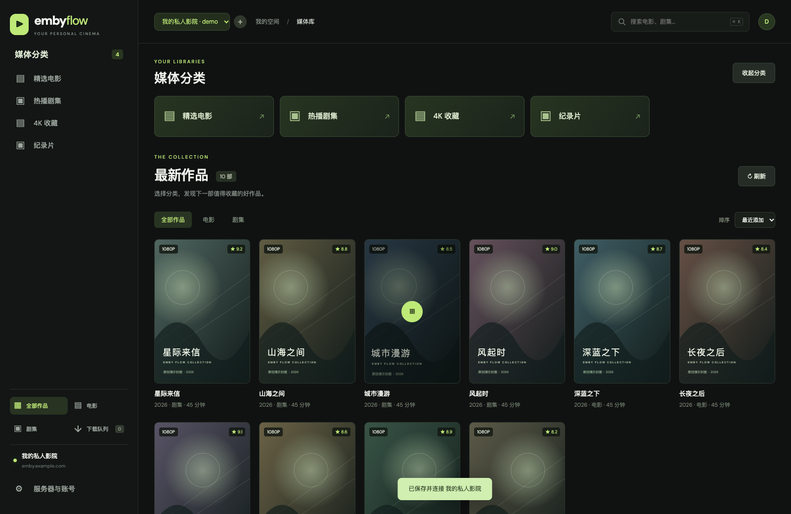
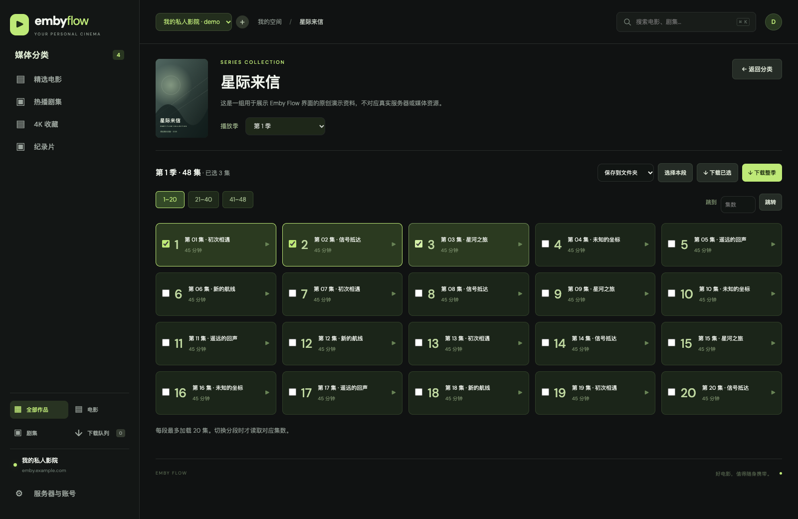
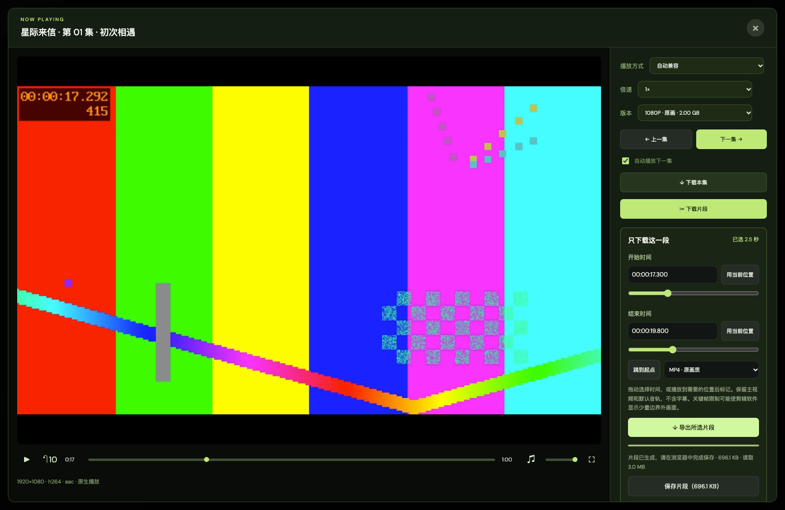
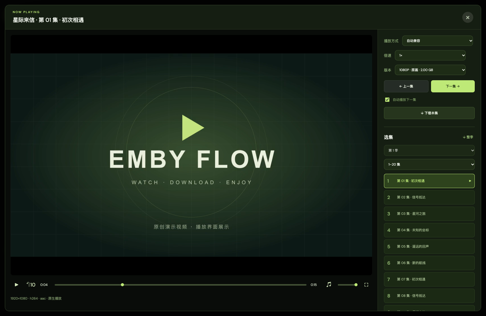

<div align="center">

# Emby Flow

### 想看的，在线播放。喜欢的，批量带走。

一款以 **视频下载** 和 **在线播放** 为核心的 Emby 网页客户端。  
多集勾选、整季下载、按时间下载片段、大画面播放器，一个界面完成。

[](LICENSE)
[](package.json)
[](https://github.com/liyongliao/emby-flow/actions/workflows/ci.yml)

[图文使用教程](docs/usage.md) · [本地运行与部署](docs/deployment.md) · [常见问题](docs/usage.md#常见问题) · [问题反馈](https://github.com/liyongliao/emby-flow/issues)



<sub>截图使用原创演示封面、虚构账号和演示视频，仅展示真实应用界面。</sub>

</div>

## 下载，是第一优先级

- **只下载片段**：在播放器中拖动选择起止时间，或用当前位置标记，导出原画质 MP4 / MKV；按索引读取所需范围，不必先保存整部影片。
- **单个视频下载**：在详情页或播放器中直接加入下载队列。
- **多集批量下载**：勾选需要的集数，支持跨分段选择；也可以选择本段全部集数。
- **整季一键下载**：一次加入整季，按顺序逐集处理，不同时拉取大量视频。
- **文件夹保存**：选择目录后流式写入，显示真实字节进度，支持暂停、重试、取消和 Range 续传。
- **浏览器保存**：不支持文件夹权限的浏览器，使用浏览器自身的下载管理器。
- **播放源下载**：通过 `PlaybackInfo` 获取当前可用播放源，再解析跳转并保存；兼容 Emby 接入 115 等来源的中转场景，不调用 Emby 的 `Items/{Id}/Download` 接口。

下载仍受账号、服务器和上游来源的实际访问限制；临时链接在任务开始时获取，失效后可重试。请用于你拥有或获准保存的媒体。



### 留下需要的几秒、几分钟

打开播放器右侧 **✂ 下载片段**，设置开始 / 结束时间，点击 **导出所选片段**。支持输入毫秒、拖动定位和用当前播放位置标记；导出时暂停播放，显示实际读取与生成大小，可随时取消。



保留主视频与默认音轨，不转码、不包含字幕。MP4 使用时间裁切信息，MKV 起点对齐此前关键帧；部分剪辑软件可能显示边界外的少量画面，可在导入后精修。需要片源具有可用索引并正确支持 Range；不满足时会停止，不自动改成整部下载。详见 [片段下载教程](docs/usage.md#6-只下载需要的片段)。

## 在线播放，同样认真

大画面播放器配合右侧控制区，播放、换集和下载不用来回切页面。

| 能力 | 说明 |
| --- | --- |
| 大画面 / 全屏 | 点击集数进入播放器，支持全屏切换 |
| 倍速与进度 | 0.5–3 倍速、音量、拖动进度、左右键快进/后退 10 秒 |
| 便捷换集 | 上一集、下一集、自动续播、右侧分段选集 |
| 播放记忆 | 记住进度；单季自动打开，多季恢复上次选择 |
| 兼容引擎 | 原生、兼容、增强兼容、软件解码，可手动切换 |
| 原始链接 | 获取 / 复制播放源，支持 IINA、VLC 外部播放入口 |



HEVC、MKV、E-AC-3 和部分杜比片源可尝试兼容引擎。Dolby Vision Profile 5/7 的色彩、增强层、HDR 和 Atmos 输出仍取决于设备、浏览器与片源，不能保证完整杜比显示链路。

## 连接更省事

- 地址直接填写 `emby.example.com` 或 `203.0.113.10:8096` 这样的格式即可，无需手动加协议；后者仅为格式示例，请换成真实公网地址。
- 优先识别 HTTPS，未识别成功时尝试 HTTP；已明确填写的协议会被保留。
- 支持粘贴 Emby 网页地址、反向代理路径前缀。
- 名称留空时，自动读取 Emby 服务器名称。
- 独立的 **确认保存** 与 **保存并连接** 按钮。
- 多服务器 / 多账号切换；密码使用 AES-GCM 在当前浏览器加密保存，密钥存入 IndexedDB，登录 token 保存在标签页 sessionStorage。

## 3 步开始

需要 **Node.js 22.13 或以上版本**，以及可正常登录、播放的公网 Emby 服务器。

```bash
git clone https://github.com/liyongliao/emby-flow.git
cd emby-flow
npm ci
npm run dev -- --port 8787
```

1. 打开 [http://127.0.0.1:8787](http://127.0.0.1:8787)，点击“连接服务器”。macOS 也可双击 `启动.command`。
2. 填写服务器地址、账号和密码，名称可留空，点击“保存并连接”。
3. 从分类进入媒体库：点击集数播放，或勾选多集后下载。

完整图解见 **[使用教程](docs/usage.md)**；生产构建、浏览器兼容及网络要求见 **[部署说明](docs/deployment.md)**。

## 使用前了解这些边界

- 服务端会代理 API、图片和视频流，运行环境需要能访问 Emby 及最终视频源。**当前代码（包括本地运行）会拒绝局域网、回环和保留地址。**
- 文件夹保存依赖浏览器的 File System Access API，建议在桌面 Chrome / Edge 的 `localhost` 或 HTTPS 页面使用。其他浏览器可以选择“浏览器逐个保存”。
- 浏览器下载模式的“已交给浏览器”表示任务已提交，真实进度和完成状态以浏览器下载管理器为准。
- 续传依赖上游正确支持 HTTP Range。来源不支持时从头重启，避免文件内容错位。
- 页面关闭后不会后台持续下载。重新打开可恢复队列记录；文件夹任务需要重新选择原目录并继续。
- 服务端不是媒体仓库，不永久保存完整视频；浏览器本地加密也不能防御设备或浏览器本身已被控制的情况。

## 开发与验证

```bash
npm test                 # 片段导出、下载队列与地址识别测试
npm run typecheck        # TypeScript 类型检查
npm run build            # 生产构建
```

```text
app/api/                 Emby、媒体解析、视频流与下载代理
app/page.tsx             页面结构
app/globals.css          响应式界面
public/app.js            媒体库、选集与播放器交互
public/flow-queue.js      顺序下载、暂停、续传与队列持久化
public/flow-clip.js       按索引读取与无损片段封装
public/flow-clip-ui.js    片段时间选择、导出与取消
public/flow-storage.js    本地账号与加密密码管理
public/flow-servers.js    地址识别与服务器名称获取
public/flow-advanced.js   增强兼容播放适配
docs/                    图文教程与部署说明
tests/                   关键边界测试
```

基于 React、Vinext、Vite 和 Cloudflare Workers 运行时构建。服务器地址、账号和密码由使用者在界面中输入；仓库不附带可登录的测试账号。

## 许可与致谢

项目原创代码使用 [MIT License](LICENSE)。播放器及其他第三方代码保留各自许可，见 [第三方声明](THIRD_PARTY_NOTICES.md)。第三方模块保持为独立可替换文件；分发修改版本时请保留相应声明和许可要求。

Emby Flow 是独立第三方项目，与 Emby、115 及其运营方无隶属或背书关系。
