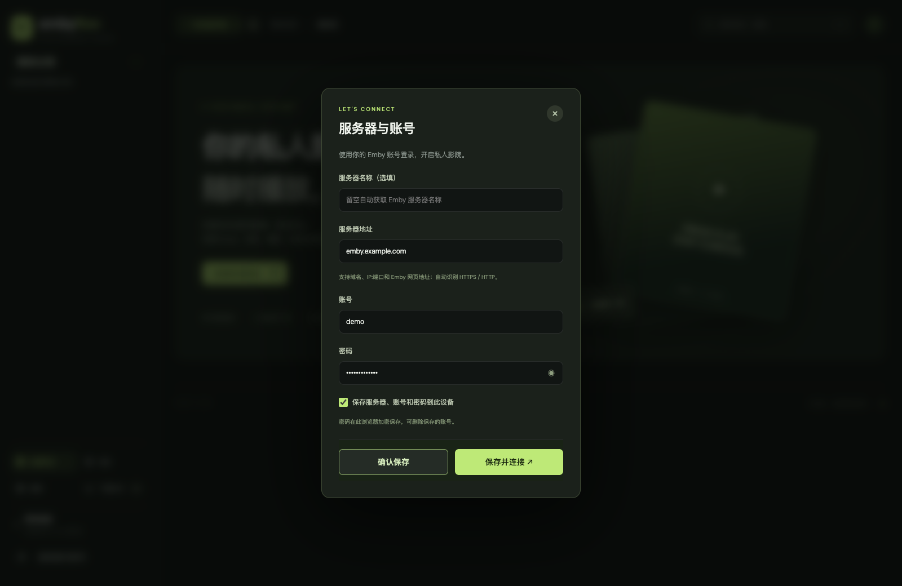
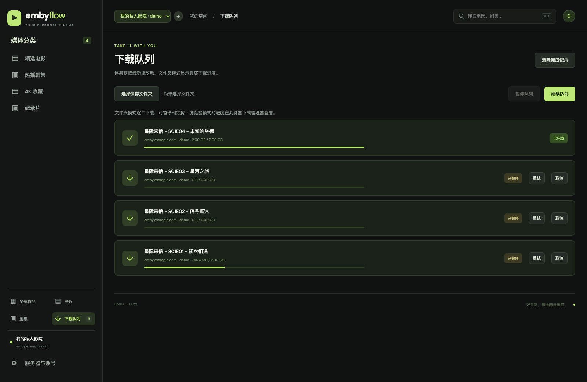

# Emby Flow 图文使用教程

[返回项目首页](../README.md) · [安装与部署](deployment.md)

本文截图使用演示数据，不包含真实服务地址、密码或可用视频链接。

## 1. 添加服务器与账号

启动应用后点击“连接服务器”，已连接时可以通过设置、头像或顶部“＋”管理服务器。

1. **服务器名称**：可留空，保存时会从 Emby 自动读取。也可以填写自己便于识别的名称。
2. **服务器地址**：填域名、域名加端口，或粘贴 Emby 网页地址。例如 `emby.example.com`、`https://emby.example.com/media/web/index.html`。请使用真实可访问的公网地址。
3. **账号与密码**：填写自己的 Emby 登录信息。
4. **保存选项**：勾选后在此设备加密保存密码；取消勾选仅保存地址和账号。
5. 点击 **确认保存** 只保存资料，留在设置窗口；点击 **保存并连接** 会保存并登录。

未写协议时，应用先读取 HTTPS 的公开服务器信息，失败后尝试 HTTP，识别后才向该地址发起登录。显式填写 `https://` 或 `http://` 时保留所选协议。

已保存账号显示在窗口上方；用编辑按钮修改、删除按钮移除本地记录。主页面顶部下拉框可在多个服务器之间切换。

“确认保存”会检查服务器可识别，不代表已经验证账号密码；“保存并连接”成功才表示登录通过。

## 2. 从媒体分类找到内容

左侧分类和页面顶部分类卡片用于进入服务器自己的媒体库。可按电影、剧集筛选，也可以搜索、排序和分页。

点击电影打开详情；点击剧集进入选集。只有一季时直接打开；多季会恢复上次选择的季和集数分段。

## 3. 多选下载或下载整季

1. 先在下载方式中选择 **保存到文件夹** 或 **浏览器逐个保存**。
2. 点选集数旁的复选框，或用 **选择本段** 勾选当前分段。
3. 可以切换到下一个分段继续选，已选集数会保留。
4. 点击 **下载所选**，把当前选择加入队列。
5. 需要整季时，直接点 **下载整季**。

每段最多展示 20 集。`1–20`、`21–40` 等按钮可快速切换，也可以输入具体集数跳转。只有明确点击下载整季时，应用才会额外读取完整集数列表；视频源在任务开始时逐个解析。

**文件夹方式**：首次选择保存目录并授权，之后本次页面会话内顺序保存。具体是否弹出目录授权，取决于浏览器。

**浏览器方式**：允许此站点下载多个文件，否则后续集数可能被浏览器阻止。实际下载速度和文件保存提示由浏览器管理。

## 4. 管理下载队列

通过左侧“下载队列”查看任务。文件夹方式显示已写入字节、总大小和百分比；可暂停、继续、取消或重试。

- 队列按顺序运行，避免一次对上游建立很多视频连接。
- 出现临时链接失效或连接中断时，可点击重试重新获取有效播放源。
- 续传要求视频源正确响应 Range；如果服务器忽略 Range，会从头覆盖重启。
- 关闭或刷新页面会中断当前传输，队列记录仍在此浏览器保留。重新选择原目录后再继续。
- “已交给浏览器”仅表示已提交下载请求，完成情况请看浏览器下载管理器。
- 清除完成记录不会删除磁盘上的文件。

## 5. 在线播放与换集

点击集数或电影详情中的播放按钮，进入大画面播放器。

右侧可调整播放引擎、片源版本和倍速，选择可用音轨 / 字幕，切换播放季、集数分段，或下载当前视频 / 整季。底部可拖动进度、调整音量、全屏。

| 操作 | 快捷方式 |
| --- | --- |
| 播放 / 暂停 | 空格键 |
| 后退 10 秒 | 方向键 ← |
| 快进 10 秒 | 方向键 → |
| 聚焦搜索 | ⌘K / Ctrl+K |

输入框、下拉框中不会触发播放器的空格和方向键快捷操作。

应用记录播放进度，恢复播放时会尝试接续。下一集按钮、自动续播和右侧选集都可以继续观看。

## 6. 只下载需要的片段

1. 打开视频，点击播放器右侧 **✂ 下载片段**。
2. 拖到需要的画面，点击开始时间旁的 **用当前位置**；再拖到结束画面，点击结束时间旁的 **用当前位置**。
3. 也可拖动两条时间滑杆，松开后播放器跳到对应位置，或直接输入 `00:12:30.500` 这样的时间。点击 **跳到起点** 可核对选择。
4. 选择 **MP4 · 原画质** 或 **MKV · 关键帧切割**，点击 **导出所选片段**。
5. 支持直接保存的桌面浏览器会先让你选择文件位置；其他浏览器在生成后触发保存，也可点击 **保存片段** 重新保存。

导出会暂停播放，显示实际读取大小、生成大小和进度。点击 **取消导出** 可以停止；关闭播放器、换集或切换版本也会取消当前导出。导出不会加入整集下载队列，刷新 / 关闭页面后需要重新选择时间。

### 画质、时间和音轨

- 直接复制编码数据并重新封装，不重新编码，保留原视频画质和主视频、默认音轨；不包含其他音轨、字幕及附件。播放器中临时切换的音轨不会改变片段的默认音轨。
- **MP4** 尽量用文件时间裁切信息呈现所选范围。为保证首帧可解码，文件内仍可能保留起点之前的关键帧数据；忽略时间裁切信息的剪辑软件可能显示额外边界画面。
- **MKV** 从所选起点之前的关键帧开始，完成后会显示实际起点。适合先获取素材，再在剪辑软件内精确裁切。
- 这不是逐帧转码裁切，也不会把 HEVC / 杜比视频变成 H.264。输出是否能在剪辑软件中打开，仍取决于其对源编码的支持。
- 若当前编码不能写入所选格式，应用会提示切换 MP4 / MKV 或选择其他版本，不会静默丢弃声音。

### 流量与浏览器限制

应用先读取容器索引，再请求片段附近的数据。实际读取量包含索引、关键帧和缓存块，通常大于输出片段的大小；在很短的源视频上，也可能读取大部分甚至全部源文件。**不是先下载整部影片再裁切**。

需有可用的 MP4 / MOV / MKV / WebM 文件索引和正确的 HTTP Range 响应。缺少索引、来源忽略分段请求或读取量异常时会停止，不回退到整部下载。当前不支持 HLS 播放列表或 MPEG-TS 文件的片段导出。

桌面 Chrome / Edge 在安全上下文中可直接写入所选文件；不支持该能力的浏览器先在内存生成，缓存上限为 **192 MiB**。达到上限时请缩短片段，或改用支持直接保存的浏览器。直接保存模式没有这项内存缓存上限，但仍受磁盘、来源响应和片源索引限制。

## 常见问题

### 下载从哪里拿链接？

先向 Emby 请求 `Items/{Id}/PlaybackInfo` 获取播放源，然后跟随来源跳转。获取和下载均沿用有效会话；不请求 Emby 的 `Items/{Id}/Download`。这适合可在线播放、来源由 115 等中转的场景，但不保证所有服务端配置都兼容，也不会解除上游自身的访问限制。

### 高清 / 杜比片源黑屏怎么办？

先试增强兼容或软件解码，再尝试另一个版本。高码率视频可能需要缓冲；部分杜比视界片源在浏览器中无法完整还原。可以获取原始链接，通过 IINA、VLC 等本机播放器打开；实际结果仍取决于本机能力。软件解码也会消耗更多处理器资源。

### 为什么手机或某些浏览器无法选文件夹？

当前浏览器可能不支持 File System Access API，或页面不在安全上下文中。改用“浏览器逐个保存”；桌面 Chrome / Edge 可在 localhost 或 HTTPS 环境尝试文件夹模式。

### 为什么填了家中 192.168 地址仍然失败？

当前代理代码主动拒绝局域网、回环和保留地址，本地运行也一样。请使用可公开访问的 Emby 地址。仅修改前端地址格式不会解除此限制。

### 保存密码后换浏览器为什么还要登录？

账号、加密密码、播放记录和队列保存在当前浏览器的当前网站来源下，不会自动同步到其他设备、浏览器或不同域名。清除站点数据也会清除这些记录。

### 链接复制后为什么过一会就不能用了？

来源可能使用短期签名、User-Agent 或 Referer 限制。回到详情页重新获取；应用下载队列会在开始任务时解析来源。请勿公开发布包含 token 或签名的视频链接。
